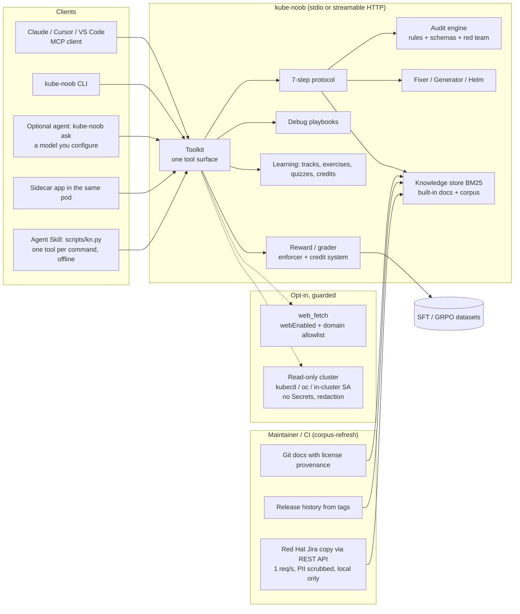

# Architecture

kube-noob has no model inside. The server, the CLI and the plugin run deterministic code: rules, schemas, playbooks,
a BM25 index and graders. A model appears only on the client side (Claude, Lightspeed, any MCP client) or in the
optional `kube-noob ask` agent, which calls the same toolkit.

## Request flow (run_protocol)

1. **Clarify** - platform/version inference (blueprint > explicit > request text > manifest API groups), blocking
   questions vs stated assumptions.
2. **Validate** - strict JSON schema (Kubernetes 1.35 + CRDs), apiVersion/kind catalog, removed APIs per target version,
   selector/port wiring.
3. **Research** - BM25 over local knowledge; results carry chunk ids, source URLs and licenses.
4. **Audit** - security, RBAC, network exposure, storage access modes vs provisioner capabilities.
5. **Calibrate** - probes, resources, replicas, PDBs, topology spread, HPA prerequisites.
6. **Generate** - deterministic generator (blueprints) or mechanical fixer (existing YAML) with a change log.
7. **Red Team** - nine adversarial scenarios evaluated on the final output; remaining HIGH/CRITICAL findings mark the
   result `blocked`.

## Trust boundaries

- MCP clients and model output are untrusted input: every tool validates with Pydantic, YAML is size/alias bounded.
  Text that came from outside is untrusted on the way out too: `kube_noob.sanitize` cleans every MCP result (invisible
  characters, role and tool-call markers, instruction phrases, exfiltrating Markdown) and flags it `untrusted`.
  Terminal and file output goes through `sanitize.visible` and its variants: every CLI text write to stdout and
  stderr at one boundary in `cli.main`, the HTML report and the Markdown writers directly. The rule is fixed in
  `sanitize` (escapes removed, other controls become a space, format characters removed and marked `<U+XXXX>`
  inside an identifier, ZWJ/ZWNJ stay after non-ASCII text), is shared with the MCP cleaner, and does not depend
  on the interpreter's Unicode table; an AST test refuses a private control-character list anywhere else. The same
  boundary breaks CI workflow commands (GitHub's `##[` and line-leading `::`, Azure's `##vso[`, TeamCity's
  `##teamcity[`) with the markers `<U+005B>` and `<U+003A>` (`sanitize.CommandGuard`), always;
  `gate --github-annotations` is the one deliberate exception. Documents (JSON, YAML, SARIF, the AdmissionReview,
  the manifests `fix` and `generate` print) bypass the text boundary and are escaped losslessly by their encoder, so
  stdout equals `-o`; comment headers kube-noob composes into them are cleaned and broken like text. `serve`, `mcp`
  and `admission serve` are not wrapped; an unexpected error is one cleaned line and exit 4 (G279).
  Pasted payloads are data too: an Alertmanager payload is read as JSON only (2 MB, 500 alerts, 64 labels, 2,000
  characters per value, every non-printing character dropped), and only an OpenShift release label sets the version.
- The Agent Skill (`skill/kube-noob/scripts/kn.py`) is a fourth surface over the same toolkit: it calls
  `kube_noob.tool_runner.call` (the code path `mcp_app.run_tool` uses), loads only the bundled copy of the server
  source next to it, and forces `offline: true`, web and cluster off and no model, whatever the config file or
  `KUBE_NOOB_*` variables say. Its trust boundary is the model that runs it: arguments are validated by the tool's
  model, input is capped at 5 MiB, and results are cleaned and flagged like MCP results.
- The directory plugin (`plugin/kube-noob-skills`) is a fifth surface with no code of its own: seven skills that tell
  Claude to run the installed CLI through its Bash tool, in a private `mktemp -d` folder, with `--format json` and
  `KUBE_NOOB_FOR_MODEL=1`. That variable makes `cli._emit` do what `tool_runner.call` does for MCP: every string goes
  through `kube_noob.sanitize`, the result is flagged `untrusted` when something was neutralised, `knowledgeAsOf` is
  stamped, and the keys that say what was not read come first. Unset, the CLI's output is unchanged. Its trust
  boundary is the user's permission settings (it pre-approves nothing) and the CLI's own argument parsing; the commands
  it runs never turn on cluster, web or model access (held by `tests/test_directory_plugin.py`).
- The HTTP transport authenticates with a bearer token (constant time) unless bound to loopback (sidecar).
- REST routes (`kube_noob.server.rest`, `/v1/...`) sit beside MCP on the same app and run the same toolkit call
  (`mcp_app.run_tool`: validation, sanitising, `knowledgeAsOf`, the content-free audit line, now with `via=rest`).
  Trust boundary: the caller holding the token. They pass the bearer check and body limit first, then the MCP
  transport's Host and Origin checks; a POST must be `application/json`, so a cross-site form cannot reach a tool.
  Only the tools the shared server offers have routes. `docs/api/openapi.json` is generated from the tools' models
  (`scripts/gen_openapi.py`) and a test keeps it equal to the code.
- Outbound HTTP only through `kube_noob.net`: web purpose requires `webEnabled` and allowlisted HTTPS hosts on every
  hop, GET only; `web_fetch` refuses non-text content types before reading the body. LLM and in-cluster API clients
  are separate, explicit purposes.
- The admin lock (`offline: true`) is applied at config load and only tightens: it disables web, refuses corpus
  downloads and allows only loopback or `*.svc` model endpoints. `kube-noob doctor` reports the result.
- Cluster access is read-only, allowlisted per resource, never Secrets, and redacts values before they reach a model.
  A failed read is never taken for an absent one: `debug.cluster.classify_read_failure` recognises "not served" and
  "not found" only as kubectl/oc's own whole stderr line (from the full redacted stderr the error carries) or
  from the in-cluster client's HTTP status, never for an aggregated API group, and calls everything else
  forbidden or not read. A body that is not JSON or UTF-8, without an `items` list or with non-object items, is
  a failed read; `policy reach --live` answers `undetermined` whenever anything a selector or tier needs was not
  read (G279).
  Diagnoses list read-only steps first; commands that execute or change state are labelled as needing approval.
  A structured playbook ties each root cause to the patterns that point at it, its own read-only steps and fixes
  (`debug.playbooks.Cause`, `debug.diagnose.likely_cause`); with no pattern matching, the first cause is shown.
  Names in steps come only from command-shaped input (`pod/<name>`, `kubectl get svc <name>`, `Selector:` lines) and
  are pasted into a command only when made of characters a shell leaves alone there, so a copied step only ever reads.
- Anything beyond reading is a capability tier (`kube_noob.tiers`: probe, dry-run, external writes, gate forwarding),
  off by default. Code that changes something is a `Writer` that cannot be built while its tier is off, and each
  action needs a person's `Approval` for that action, unexpired and used once. The read-only backends have no write
  method; tier RBAC renders only when the tier is on.
- A memory repository (`kube_noob.memory`) is the team's own Git content: kube-noob reads it locally, writes only on
  `memory init`, `add`, `outcome` and `migrate-learning` (new files created exclusively, rewrites atomic), never runs
  git, and never bundles, publishes or exports it. Entries are untrusted input until `memory validate` passes:
  bounded YAML, content rules, and the verifier on every fix (validate, audit and red team on patches; privileged
  SCC, cluster-admin, hostPath and wildcard RBAC grants fail without a recorded risk acceptance). In the chart the
  repository is mounted read-only; the git source is cloned by an init container (no credentials in the URL, a
  deploy key from a Secret, strict host keys), with egress only to the git host's CIDRs and, under the offline
  lock, only from an in-cluster host.
- The Red Hat Jira copy is local data that is not redistributable. Each sync appends status, resolution and
  fix-version changes to `jira/changes.jsonl` (owner-only, atomic, capped); reconciliation reads it and the ticket
  index offline. A snapshot (`corpus jira-snapshot`) is owner-only; `corpus import` validates its file names,
  sizes, checksums and that it comes from the same Jira before copying anything. `serve` imports a seed from
  `<dataDir>/seed/` only when there is no copy, and the chart mounts the seed read-only (an init container copies it
  from a pinned image, or a read-only claim). The scheduled main copy leaves the runner only encrypted.
- A sealed Jira seed is opened in the server container only, with the key file from a Secret; the init container
  that copies it never sees the key. The plaintext is written to a temporary folder next to the data, imported
  through the same validation as any snapshot, and removed; a wrong key leaves the data folder untouched.
- The public `kube-noob-db` bundle is the only data kube-noob publishes. It is built from redistributable sources
  only, checked by `corpus db-check` (allow-listed licenses, no Jira data, every file listed and checksummed), and
  shipped in an image the chart pins by digest. The init container copies the archive into a scratch volume that the
  server mounts read-only; `serve` validates the whole archive and imports it only when it is newer than the copy
  it has. Trust boundary: the image registry and its signature, checked by the operator with `cosign verify`.
- The attack-path scan (`posture scan`, tools `posture_scan` and `cluster_posture_scan`) reads RBAC objects (who may do what, no credentials) and the objects that expose and run pods; Secret objects in a bundle are dropped before analysis, and the live allowlist refuses Secrets. It reports paths and fixes and changes nothing. The blast radius (`posture reach`, tools `posture_reach` and `cluster_posture_reach`) reads the same objects through the same reader and names the Secrets an account may read only by the `resourceNames` and scopes in RBAC rules; its Mermaid output escapes every label and its text output (and the scan's) prints every field on one line, since object names are input that would otherwise reach whatever renders the diagram or forge a row in a terminal; and its result is bounded in bytes (96 KB, diagram included) before it reaches an MCP caller, every list in it included. Of a Secret in the input, the scan keeps only whether its type is `kubernetes.io/service-account-token` and the account its annotation names, so a legacy token mounted by a pod is followed; the Secret's data is never read and the object is then dropped. With cluster access it lists Gateway API HTTPRoutes and GRPCRoutes and Istio VirtualServices (read-only, namespaced) as exposure; a failed list, 404 included, leaves exposure not determined. A route can set or match header values that are credentials (`Authorization`, an API key), so the backend masks every value under a route's header blocks before any reader or MCP caller sees it.
- Build analytics (`kube_noob.build.analytics`) reads run folders on disk; JUnit XML with a DOCTYPE or entities is refused before parsing, and every file is size-bounded. `kube_noob.build.github_history` is the only code that reads the GitHub token: through `net.Purpose.CI` (on only with `ci.githubEnabled`, GET only, https to the configured API host and port only, no redirects), with a random pause between requests; the Claude plugin does not ship it.
- The CI gate (`kube_noob.gate`) is offline: it reads the files it is given (and runs `helm template` for `--chart`, with a throwaway Helm home), audits them together so rules that need other objects still work, maps each finding back to its file and line (or chart template), and writes SARIF, Markdown and code quality JSON. The GitHub Action installs kube-noob from its own source with hash-pinned dependencies and a hash-pinned build backend and passes every input through the environment; the Tekton Task mounts the source read-only and passes params through the environment.
- Build insight (`kube_noob.build`) reads text and files the user gives it and runs nothing: logs are split into steps by each CI system's own markers and classified by bounded patterns; the Containerfile audit parses without running a shell; the OCI layout reader opens blobs only by validated digest, refuses symlinks, checks every blob's sha256, reads layers as tar streams in memory with byte, file and layer budgets, and reports credentials by kind and location only (never their value). Trust boundary: the files on disk.
- Vulnerability assessment (`kube_noob.vuln`) reads scanner reports, SBOMs, CSAF VEX and the KEV catalog the user gives it, as bounded JSON, and runs and fetches nothing; VEX statements come from the local `redhat-vex` corpus shard or files on disk, RHACS image scans only through the Central reader (`rhacs.enabled`, GET `/v1/images/<digest>` with the same guards as policies). The threat model reads manifests through the attack-path inventory, so Secret objects are dropped unread. The Claude plugin ships the parsers and the CSAF reader (`kube_noob.vuln.csaf`), not the VEX fetcher or archive reader. Trust boundary: the scanner, SBOM and VEX producers. kube-noob trusts Red Hat's VEX statements for Red Hat builds and cites them; it does not let a report clear its own findings (CycloneDX analysis needs `--trust-report-vex`), escapes report text before it reaches the job summary, and flattens control characters in every name it reads.
- The admission webhook (`kube_noob.admission`, `kube-noob admission serve`, chart `admission.enabled`) receives the AdmissionReview requests the API server sends it over TLS (its rules never match Secrets or ConfigMaps), evaluates the object with the audit engine in memory and answers with warnings, or a denial for a rule in `admission.enforce`. It never mutates, keeps only request counters and latency buckets (`/metrics`), and connects to nothing; with `admission.lookups` a background thread lists PodDisruptionBudgets, NetworkPolicies, PersistentVolumeClaims, HorizontalPodAutoscalers and StorageClasses read-only, with jittered pauses, and a request never waits for it. Any error admits the object with a warning (fail open, like its `failurePolicy: Ignore`). Trust boundary: the API server is the only intended caller; port 8443 is open to every source by default because the API server is rarely a pod a NetworkPolicy can name, which is safe because a caller learns only the findings of an object it sends (with lookups, also whether its namespace has a matching budget or policy); `admission.networkPolicy.from` narrows it.
- Must-gather ingest (`kube_noob.mustgather.ingest`) reads a directory with `os.walk` (no links followed, files opened with `O_NOFOLLOW`, only regular files) or a tar archive as a stream (`tarfile` mode `r|*`, never `extract`), in memory, under caps on file count, bytes processed, file size, memory kept and depth. Trust boundary: the must-gather is untrusted; a traversal member refuses the archive, Secrets-named files are never opened (OLM object files in the `operators.coreos.com` layout excepted: their names are operators' and namespaces'), every skipped path is recorded for readers that need to tell "absent" from "skipped", and member names with control characters are skipped.
- Must-gather analysers (`kube_noob.mustgather.analyse`) read only what ingest kept. Resource YAML is parsed with
  libyaml after an event pre-scan (libyaml's event parser keeps an explicit stack; its composer recurses and crashes
  the process on very deep input) that refuses aliases, more than 10 documents and nesting deeper than 64, under a
  768 MiB parse budget. Trust boundary: everything in the must-gather is untrusted; shown strings are flattened and
  redacted, names reach next-step commands only when they are valid Kubernetes names, and the output is bounded
  (150 findings per analyser, 500 in all, 25 event reasons).
- Must-gather report (`kube_noob.mustgather.report`) matches the 20 most severe findings against the bundled known
  issues (and the local Jira cache) for the detected version and against approved team memory, offline. It writes
  `report.md`, `report.json` and `case-draft.md` into the directory given (never through a symbolic link). Trust
  boundary: as for the analysers; the report adds only indexed facts, the draft leaves every human fact as a
  placeholder, and the must-gather's own path is reduced to its file name.
- MCP `analyze_must_gather` (toolkit) reads a path the caller names. Trust boundary: the caller. The local stdio
  server runs as the user and reads any absolute path; a shared (HTTP) server offers the tool only with
  `mustGather.allowedDir` and refuses a path whose resolved form (links followed) leaves it. The modules are guarded
  out of the Claude plugin.
- The operator inventory (`kube_noob.operators`; `operators inventory`, tools `operator_inventory` and
  `cluster_operator_inventory`, and `operatorInventory` in `must-gather analyze` and `analyze_must_gather`) reads
  OLM objects and changes nothing: manifests through `yamlio`, one file at a time (Secret objects dropped unread),
  a must-gather through the analysers' loader (`kube_noob.mustgather.operators`, not in the Claude plugin), or the
  cluster through the read-only allowlist (`clusterserviceversions` and `subscriptions` only; cluster-wide with the
  `!olm.copiedFrom` selector OLM itself uses). Only named fields are read, never a Subscription's `spec.config`, and
  only objects of the `operators.coreos.com` group. Trust boundary: the input is untrusted; shown strings are made
  printable by Unicode category (`sanitize.visible`) and redacted, a name or version that is not valid is not shown
  as one, the output is bounded (500 operators, 100 namespaces each) and sorted, and evidence names objects and
  files rather than positions, so order never changes the bytes. What could not be read is part of the answer:
  every skipped, unparseable, misplaced, empty, foreign or truncated input makes the verdict `partial` and is named;
  no ClusterServiceVersions read is "not determined"; only a 404 in the backends' exact words on both reads is "not
  an OLM cluster". The must-gather reader's rule that files named like Secrets are never read does not apply to
  files in the OLM layout, whose names are operators' and namespaces'.
- The operator known-issue lookup (`kube_noob.operator_issues`; `operators issues`, tools `operator_known_issues` and
  `cluster_operator_known_issues`, and `operatorKnownIssues` in `must-gather analyze` and `analyze_must_gather`)
  reads the operators through the inventory's own collection, and the cluster's version from the ClusterVersion
  named `version`: live, one get on `clusterversions` (already on the allowlist); from a must-gather, through the
  analysers, so `operators issues --must-gather` runs every must-gather analyser to find it. It matches them against
  the bundled release-note index or the newer local copy, offline. Trust boundary: as for the inventory; a local copy
  of the index is data from outside too, so `known_issues` checks every record when it loads it -- issue keys, versions
  in ASCII digits, sources that are release-notes files under the openshift-docs prefix, dates that are dates -- and
  leaves out, counts and names (bounded) any that fail, in what every consumer of the index returns; a copy whose
  `retrievedAt` is not a date does not replace the bundled one (whether a date is in the future is not checked: a
  pure function has no clock). Matching is by an explicit table of names (whole phrases, case-sensitive), never by
  free-text search, and nothing in the index is compared with an operator's version. The index is OpenShift
  Container Platform's: a cluster that does not serve ClusterVersion, or whose version carries OKD's `okd` suffix, is
  answered "not determined" with that reason rather than from notes that do not describe it.
- Code findings (`kube_noob.code`) read SARIF, Containerfiles, manifests, scanner reports and dependency files as bounded text and run nothing: no analysis engine, no package resolution, no network. The CLI reads the Containerfiles, `.dockerignore` and dependency files under `--repo` (no symlinks followed, at most 500 dependency files of 5 MB); the MCP tool takes everything inline and reads no files. Trust boundary: the SAST tools and scanners; kube-noob trusts their findings, never their paths (a path outside the source root, or one that decodes to control characters, is reported as unresolved, not opened, and its shipping counts as unknown, which gates like shipped code). Containerfile and context paths resolve inside `--repo` (the gate: the working directory) and become repository-relative; stage traversal is memoised and SARIF merging is indexed, so input inside the bounds costs linear work; dependency patterns never run on lines over 4 KB.
- The RHACS comparison (`kube_noob.rhacs`) reads a policy export as data and changes nothing. Reading Central goes through `net.Purpose.RHACS`: on only with `rhacs.enabled`, GET only, https to the configured host and port only, no redirects, the token from `$ROX_API_TOKEN` (or the KUBE_NOOB_* variable `rhacs.tokenEnv` names) in the Authorization header and never in an error; `kube_noob.rhacs_central` is the only code that reads it, and the Claude plugin does not ship it, Central's CA from `rhacs.caFile`; under the offline lock only a loopback or `*.svc` Central with no proxy from the environment. Trust boundary: Central and the token's role.
- Alert evidence reports (`kube_noob.alert_report`, `kube_noob.alert_store`; `POST /v1/alert-reports`, `GET
  /v1/alert-reports[/<id>]`, the `alert_report*` tools, `kube-noob alerts`). Trust boundary: whoever can post with the
  bearer token, and through it whoever can put text in an alert's labels and annotations. The payload is read with the
  bounds above; each label and annotation value is redacted before it is clipped and its `scheme://` URLs are
  replaced; each alert is handed alone to the `diagnose` tool (no cluster read, no fetch), with the names its steps may
  use taken for the namespace and pod only from the alert's own labels (other names, such as a forbidden message's
  verb and user, still from its text) and only when they are valid Kubernetes names; a `service` label that names the
  scrape target (kube-state-metrics, `job` equal to it, an `endpoint` label) is not the alert's service, except on
  TargetDown, whose subject is the target; an exporter's own pod and namespace (node-exporter, a monitoring namespace on
  a node alert) are not the subject, and `exported_namespace`/`exported_pod` are the subject whenever present
  (`signals.alertmanager.subject_labels`, which cites the upstream ServiceMonitors). A post gets
  `alertReports.budgetSeconds` of work counted from receipt, then the alerts not reached keep `not-evaluated` rows. At
  most two reports are built at once by the receiver and the `alert_report` MCP tool together (one set of slots in the
  Toolkit). The receiver reads the body first (1.5 MiB, within 10 s or 408, holding a large-body ticket while it is
  over 256 KiB), then takes a slot on the event loop, answers 503 with `Retry-After` when none comes free within 5 s
  (an MCP call takes its slot the same way, before its worker thread starts, and gets a busy tool error), and drops a
  post whose sender has gone without building or keeping
  it. The body is read, the report built and the answer rendered in worker threads, so a large post cannot stall
  `/healthz` or another route. Only the HTTP server writes reports, into `<dataDir>/alert-reports`:
  the folder is opened with `O_NOFOLLOW` and must be the process's own (made 0700 by the writer only), files are
  created `O_EXCL | O_NOFOLLOW` at 0600 relative to it and renamed into place, and retention
  (`alertReports.maxReports`, `maxAgeDays`) runs after every write, never removes the report just written, and
  counts what it could not remove instead of stopping. Ids are `<UTC time>-<96 random bits>`, checked against
  `[0-9]` and `\Z` with no separator before they name a file. An entry named like a report that is not a regular
  file is ignored, counted in the list and never counted toward the cap. Reports read back are untrusted:
  `O_NOFOLLOW`, regular files with one link owned by the process, under the size cap, depth-bounded JSON, every field type-checked, cleaned again on the tool path; a damaged
  one is a 500 naming no path. Writing one is kube-noob's own local state, like drift snapshots: no tier, nothing in
  a cluster or anywhere else. The chart keeps none by default, because each of its two replicas has its own volume.
- Drift snapshots and reports (`kube_noob.drift`) are local files, owner-only, with hashes and names only: a snapshot cannot be turned back into configuration. The daily job reads through the same read-only allowlist.
- `policy generate` (CLI and the read-only `policy_generate` tool) only writes YAML: it applies nothing, reads no
  cluster and fetches nothing. What the policies do is decided by the person who applies them; enforce mode refuses
  requests, so the default is audit. The CEL reads only the admitted object and the requester's name, never other
  objects, and exempts platform namespaces and operators so a cluster upgrade is never blocked by a generated policy.
- `examples copy` (CLI only; `kube_noob.examples`) writes the example files bundled in the package, and nothing
  else, into the directory the user names. Every target is checked before any is written: a file already there byte
  for byte is left alone, one that differs is refused unless `--force`, and a symbolic link (the directory itself,
  a dangling parent, or a target) or anything that is not a regular file is refused even then; a directory name with
  a control or invisible character is refused. The directory is opened once (`O_DIRECTORY`, `O_NOFOLLOW`) and every
  check, write and rename is relative to that descriptor, so a directory swapped for a link after the check is not
  followed. Files are written under unpredictable temporary names (`O_EXCL`, `O_NOFOLLOW`, umask permissions) and
  moved into place only when all were written (a hard link, so a name that appeared meanwhile is not replaced, or a
  checked rename where the file system has no hard links; `os.replace` under `--force`); a failure part way, Ctrl-C
  included, removes what the run wrote (exit 4, or 130 for Ctrl-C).
  `demo <name> --keep DIR` writes through the same code. Trust boundary: the user's own directory; the content is
  the package's.
- `policy migrate-check` (CLI and the read-only `policy_migrate_check` tool; `kube_noob.kyverno_migrate`) reads legacy
  Kyverno policies as bounded YAML (the `yamlio` caps, Secret documents skipped unread) and rewrites, applies and
  fetches nothing. Its verdicts come from mapping tables pinned to kyverno/website and kyverno/kyverno commits; a draft
  CEL policy is text labelled as a draft, and the `kyverno test` skeleton beside it is how equivalence gets proven.
  With `-o` the CLI writes only new files under the given directory, from sanitised names, and refuses to overwrite.
- `<dataDir>/learning.json` holds user-confirmed summaries, the user's profile and id counters only. Notes are indexed
  as `origin: local`, are never redistributable and never exported as training data.
- Evaluation (maintainer tools, not shipped in the package or plugin): `scripts/eval_questions.py` reads a question
  CSV that is third-party text (forum posts, accepted answers, Jira resolutions) from outside the repository, runs
  each row through `insight` offline and writes ids, answer kinds, finding ids and scores only: no question or answer
  text. Only ids, verdicts, retired ids and aggregates are committed (`docs/evals/`). `scripts/eval_golden.py`
  reads `tests/fixtures/golden/`, original questions written from the official docs with their source pinned to a
  commit, and fails CI when a passing item regresses. Trust boundary: the CSV is untrusted input, read with a bounded
  field size; nothing from it is executed.
